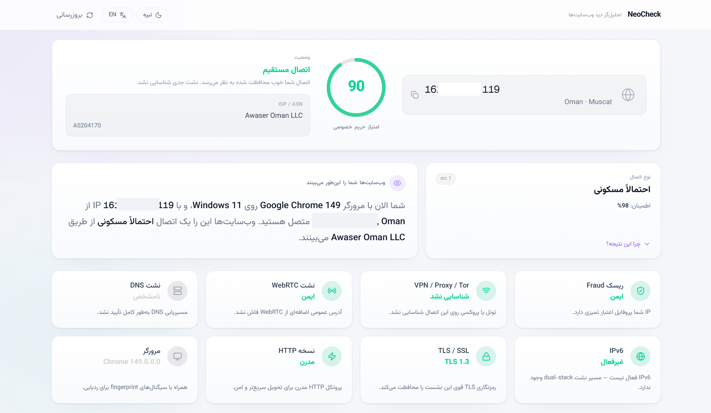
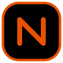

<!-- neo:header:start · generated by neoproject/brand/readme, edit config.json instead -->
<div align="center">


<h1>NeoCheck</h1>

<p><b>وضعیت اتصال و حریم خصوصی‌تان را در چند ثانیه بشناسید</b><br>
<sub>Know your connection in seconds: privacy score, IP reputation, leaks and TLS</sub></p>

<p>
  <a href="https://github.com/neoauroraproject/neocheck/stargazers"></a>
  
</p>

<p>
  <a href="#-نصب-با-یک-کلیک-سرور-اوبونتو"></a>
  <a href="https://t.me/neoaurora"></a>
</p>

<p>
  <a href="https://neoproject.dev/neocheck"></a>
</p>

<p><a href="#english"><b>English</b></a> &nbsp;·&nbsp; <a href="#persian-فارسی"><b>فارسی</b></a></p>



</div>
<!-- neo:header:end -->

<h2 id="english">🇬🇧 English Documentation</h2>

**NeoCheck** is a beautiful, fast, and secure network diagnostics dashboard. It analyzes your connection properties, geolocation, security, and IP reputation in real-time.

### ✨ What Does It Check?
- **🌍 Geolocation & IP Info:** Identifies your public IP, country, city, and ISP.
- **🛡️ Security Profile:** Detects if you are using a VPN, Proxy, Tor, or Datacenter IP.
- **💻 Browser & System:** Shows your operating system, browser version, and platform.
- **🌐 Network Protocols:** Checks for IPv6 availability and HTTP/TLS versions.
- **🎯 Reverse DNS (rDNS):** Resolves the hostname associated with your IP.
- **📊 Health Score:** Provides an overall connection health score (0-100).

<div align="center">
  <p>Official Demo: <a href="https://ip.hmray.pro">IP.HMRAY.PRO</a></p>
</div>

### 🚀 1-Click Installation (Ubuntu Server)
Deploy NeoCheck on your server in seconds. The installer handles Docker, configurations, and startup automatically.

```bash
curl -fsSL https://raw.githubusercontent.com/neoauroraproject/neocheck/master/install.sh | sudo bash
```

### 🔒 SSL & Custom Branding
During the installation, you will be asked if you want to enable SSL.
- **Enable SSL? (Y/N):** Type `Y` if you have a certificate.
- **SSL Certificate:** Provide the absolute path to your `.crt` or `.pem` file (e.g., `/etc/letsencrypt/live/yourdomain.com/fullchain.pem`).
- **SSL Private Key:** Provide the absolute path to your `.key` file (e.g., `/etc/letsencrypt/live/yourdomain.com/privkey.pem`).

You can customize the **Brand Name**, **Logo**, **Colors**, and **Links** anytime from the **Admin Settings Panel** after installation.

### ⚙️ Quick Management
Manage your instance directly from the installation directory (`/opt/neocheck`):
- **Start:** `docker compose up -d`
- **Stop:** `docker compose down`
- **View Logs:** `docker compose logs -f`

---

<h2 id="persian-فارسی">🇮🇷 مستندات فارسی</h2>

**نئوچک (NeoCheck)** یک داشبورد زیبا، سریع و امن برای عیب‌یابی و بررسی شبکه است. این ابزار ویژگی‌های اتصال، موقعیت مکانی، امنیت و اعتبار آی‌پی شما را در لحظه تحلیل می‌کند.

### ✨ چه مواردی را بررسی می‌کند؟
- **🌍 موقعیت مکانی و آی‌پی:** شناسایی آی‌پی عمومی، کشور، شهر و شرکت ارائه‌دهنده اینترنت (ISP).
- **🛡️ پروفایل امنیتی:** تشخیص استفاده از VPN، پروکسی، شبکه Tor یا آی‌پی‌های دیتاسنتر.
- **💻 مرورگر و سیستم:** نمایش سیستم‌عامل، نسخه مرورگر و پلتفرم کاربر.
- **🌐 پروتکل‌های شبکه:** بررسی دسترسی به IPv6 و نسخه‌های HTTP و TLS.
- **🎯 دی‌ان‌اس معکوس (rDNS):** پیدا کردن نام میزبان (Hostname) متصل به آی‌پی.
- **📊 امتیاز سلامت:** ارائه یک امتیاز کلی از ۰ تا ۱۰۰ برای سلامت اتصال شما.

### 🚀 نصب با یک کلیک (سرور اوبونتو)
نئوچک را در چند ثانیه روی سرور خود نصب کنید. این اسکریپت تمام مراحل نصب داکر، تنظیمات و اجرای اولیه را به صورت خودکار انجام می‌دهد.

```bash
curl -fsSL https://raw.githubusercontent.com/neoauroraproject/neocheck/master/install.sh | sudo bash
```

### 🔒 تنظیمات SSL و شخصی‌سازی برند
در حین نصب، از شما پرسیده می‌شود که آیا مایل به فعال‌سازی SSL هستید یا خیر.
- **فعال‌سازی SSL:** در صورت داشتن گواهینامه، کلید `Y` را وارد کنید.
- **گواهینامه SSL:** مسیر فایل `.crt` یا `.pem` خود را وارد کنید (مثال: `/etc/letsencrypt/live/yourdomain.com/fullchain.pem`).
- **کلید خصوصی SSL:** مسیر فایل `.key` خود را وارد کنید (مثال: `/etc/letsencrypt/live/yourdomain.com/privkey.pem`).

پس از نصب، می‌توانید **نام برند**، **لوگو**، **رنگ‌ها** و **لینک‌ها** را در هر زمان از طریق **پنل تنظیمات ادمین** شخصی‌سازی کنید.

### ⚙️ مدیریت سریع
سیستم خود را از مسیر نصب (`/opt/neocheck`) به راحتی مدیریت کنید:
- **روشن کردن:** `docker compose up -d`
- **خاموش کردن:** `docker compose down`
- **مشاهده لاگ‌ها:** `docker compose logs -f`

<!-- neo:footer:start · generated by neoproject/brand/readme, edit config.json instead -->
<div align="center">

---

<a href="https://neoproject.dev"></a>

<h1><a href="https://neoproject.dev">neoproject.dev</a></h1>

<p><b>NeoCheck</b> is part of <b>NeoProject</b>: open tools for a free and open internet.<br>
<sub>NeoCheck بخشی از NeoProject است؛ ابزارهایی برای اینترنت آزاد.</sub></p>

<p>
  <a href="https://t.me/neoaurora"></a>
  <a href="https://t.me/hmpanel"></a>
  <a href="https://t.me/neotunnels"></a>
</p>
<p>
  <a href="https://t.me/hmraysupport"></a>
  <a href="https://t.me/neolicensebot"></a>
</p>

<p><a href="https://neoproject.dev/projects"><b>All projects</b></a> &nbsp;·&nbsp; <a href="https://github.com/neoauroraproject/hmpanel">HMPanel</a> &nbsp;·&nbsp; <a href="https://github.com/neoauroraproject/neotunnel">NeoTunnel</a> &nbsp;·&nbsp; <a href="https://github.com/neoauroraproject/Neo-Uptime">NeoUptime</a> &nbsp;·&nbsp; <a href="https://github.com/neoauroraproject/neoexit">NeoExit</a> &nbsp;·&nbsp; <a href="https://github.com/neoauroraproject/neopaste">NeoPaste</a> &nbsp;·&nbsp; <a href="https://github.com/neoauroraproject/NeoTemplate">NeoTemplate</a> &nbsp;·&nbsp; <a href="https://github.com/neoauroraproject/NeoConfig">NeoConfig</a></p>

<br>

<a href="https://neoproject.dev/donate"></a>

<p><sub>USDT · TON · TRON · Telegram Stars: all addresses and QR codes are on <a href="https://neoproject.dev/donate">neoproject.dev/donate</a></sub></p>

<p>⭐ <b>Enjoying NeoCheck? Give it a star.</b> Every star helps more people find it.</p>

<sub>© 2026 NeoProject · <a href="https://github.com/neoauroraproject">GitHub</a> · <a href="https://neoproject.dev">neoproject.dev</a></sub>

</div>
<!-- neo:footer:end -->
